# MLLM Related Re-Identification

本仓库系统整理多模态大语言模型（MLLM）、大型视觉语言模型（LVLM）与 Re-Identification（ReID）交叉领域的研究工作，重点关注大模型在行人重识别、交互式行人检索、多模态特征学习和跨模态检索中的应用。

论文按照研究方向进行分类，并为每篇论文添加方向标签，方便研究人员快速定位相关工作。

**25 Reviewed Papers | 16 Core ReID Papers | 9 Related Methods**

论文配图取自 [Awesome-MLLM-ReID](https://github.com/Reflection0427/Awesome-MLLM-ReID/tree/f164f463db19dffe7e923c48580d71cad667a0f9/assets/frameworks) 收录的原论文框架图。点击缩略图可查看原图，图号链接指向论文 PDF。图片版权归各论文作者或出版方所有。

## 1. Research Categories

### Core MLLM / LVLM ReID

直接将大模型应用于行人或目标重识别任务的研究。

| Research Direction | Description |
|---|---|
| Interactive ReID | 通过多轮交互、主动提问和用户反馈优化目标检索 |
| General ReID | 利用 MLLM/LVLM 提升行人重识别能力 |
| Text-to-Image ReID | 利用语言描述实现跨模态行人检索 |
| Domain Generalization | 提升模型在不同数据集、场景和域之间的泛化能力 |
| Multimodal Alignment | 学习视觉、语言等不同模态之间的语义对应关系 |
| Object ReID | 将大模型应用于多模态目标重识别 |
| ReID Benchmark | 构建大模型行人重识别评测体系 |

### Related MLLM Retrieval / Re-ranking

虽然并非全部直接面向 ReID，但其检索、嵌入、重排序和知识蒸馏方法具有较高的迁移价值。

| Research Direction | Description |
|---|---|
| Multimodal Retrieval | 利用多模态大模型完成跨模态检索 |
| Multimodal Embedding | 学习统一的多模态向量表示 |
| Re-ranking | 对初始检索结果进行二次排序和优化 |
| Composed Image Retrieval | 根据参考图像和文本修改指令检索目标图像 |
| Knowledge Distillation | 将大模型能力迁移到轻量化检索模型 |

---

## 2. Core MLLM / LVLM ReID

### 2.1 Interactive Person Re-Identification

**研究重点：** 通过多轮对话、主动提问和用户反馈，逐步缩小候选身份范围，提高复杂场景下的行人检索准确性。

| Venue | Method | Paper | Code | Direction Tags | Framework |
|---|---|---|---|---|---|
| ICML 2026 | MNEMO | [Paper](https://proceedings.mlr.press/v306/bai26j.html) | [Code](https://github.com/Flame-Chasers/MNEMO) | `Interactive ReID` `Multi-turn Dialogue` | <a href="assets/frameworks/mnemo.png">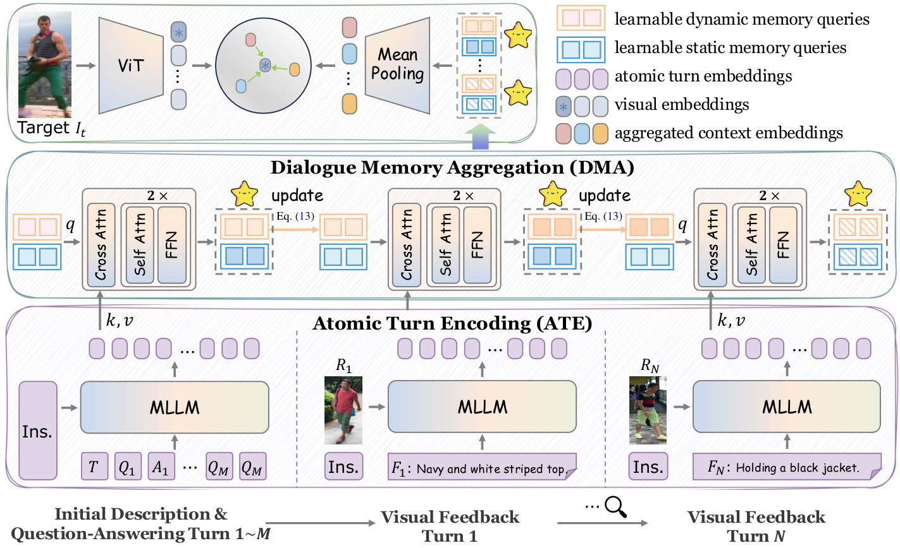</a> <a href="https://raw.githubusercontent.com/mlresearch/v306/main/assets/bai26j/bai26j.pdf">Figure 2 · PDF</a> |
| ICCV 2025 | ChatReID | [Paper](https://openaccess.thecvf.com/content/ICCV2025/html/Niu_ChatReID_Open-ended_Interactive_Person_Retrieval_via_Hierarchical_Progressive_Tuning_for_ICCV_2025_paper.html) | — | `Interactive ReID` `Progressive Tuning` | <a href="assets/frameworks/chatreid.png">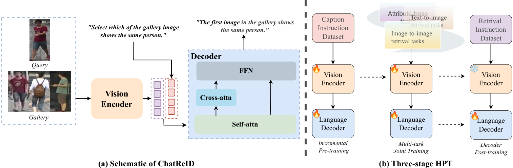</a> <a href="https://arxiv.org/pdf/2502.19958v3">Figure 3 · PDF</a> |
| ICML 2025 | LLaVA-ReID | [Paper](https://proceedings.mlr.press/v267/lu25s.html) | [Code](https://github.com/XLearning-SCU/LLaVA-ReID) | `Interactive ReID` `Active Questioning` | <a href="assets/frameworks/llava-reid.png">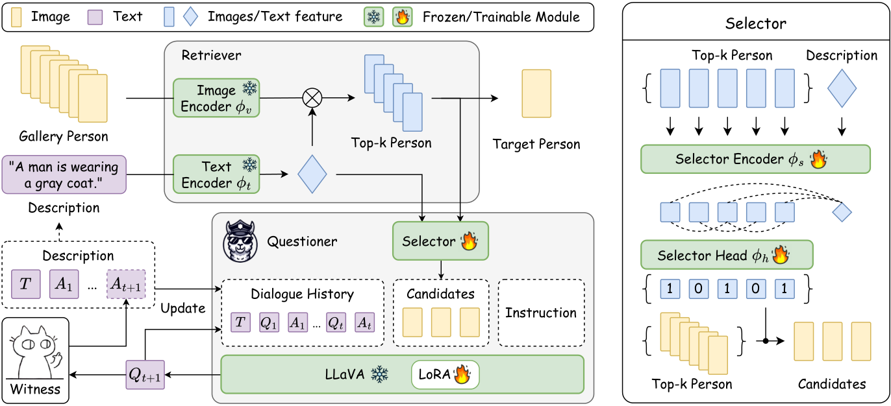</a> <a href="https://arxiv.org/pdf/2504.10174v3">Figure 3 · PDF</a> |
| CVPR 2025 | ICL | [Paper](https://openaccess.thecvf.com/content/CVPR2025/html/Qin_Human-centered_Interactive_Learning_via_MLLMs_for_Text-to-Image_Person_Re-identification_CVPR_2025_paper.html) | [Code](https://github.com/QinYang79/ICL) | `Interactive ReID` `Human-in-the-loop` | <a href="assets/frameworks/icl-reid.png">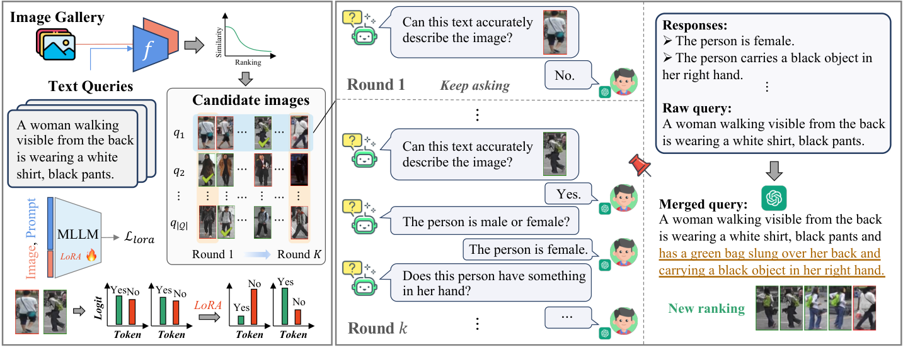</a> <a href="https://openaccess.thecvf.com/content/CVPR2025/papers/Qin_Human-centered_Interactive_Learning_via_MLLMs_for_Text-to-Image_Person_Re-identification_CVPR_2025_paper.pdf">Figure 2 · PDF</a> |

### 2.2 General MLLM-based ReID

**研究重点：** 探索多模态大模型在 ReID 特征提取、视觉语义理解、推理和检索任务中的应用。

| Venue | Method | Paper | Code | Direction Tags | Framework |
|---|---|---|---|---|---|
| CVPR 2026 | CoT-ReID | [Paper](https://openaccess.thecvf.com/content/CVPR2026/html/Gao_Chain-of-Thought_Guided_Multi-Modal_Object_Re-Identification_CVPR_2026_paper.html) | [Code](https://github.com/Gaoya615/CoT-ReID) | `Object ReID` `Chain-of-Thought` | <a href="assets/frameworks/cot-reid.png">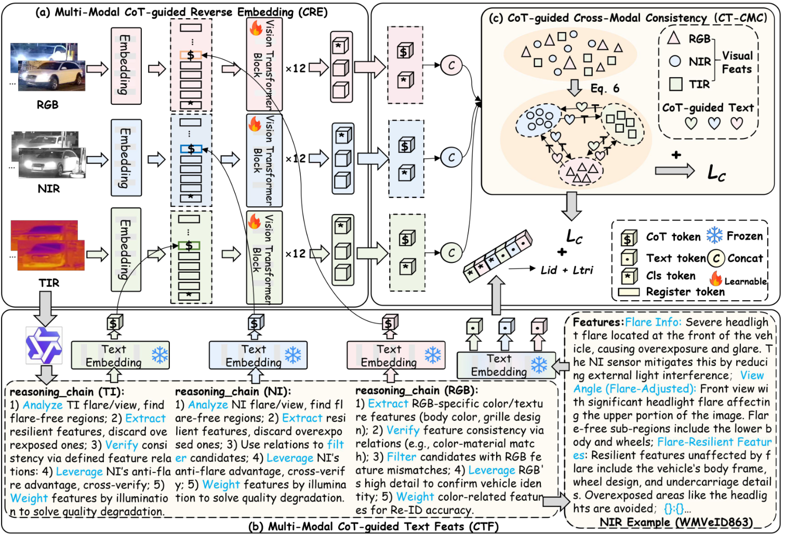</a> <a href="https://openaccess.thecvf.com/content/CVPR2026/papers/Gao_Chain-of-Thought_Guided_Multi-Modal_Object_Re-Identification_CVPR_2026_paper.pdf">Figure 4 · PDF</a> |
| ICASSP 2026 | LVLM-ReID | [Paper](https://doi.org/10.1109/ICASSP55912.2026.11460593) | — | `General ReID` `LVLM` | <a href="assets/frameworks/lvlm-reid.png">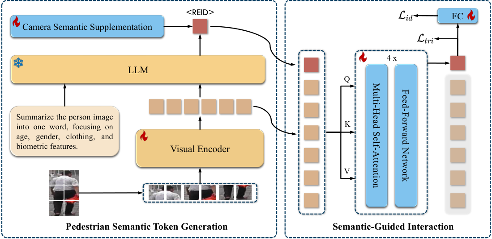</a> <a href="https://arxiv.org/pdf/2411.18111v2">Figure 2 · PDF</a> |
| CVPR 2024 | Instruct-ReID | [Paper](https://openaccess.thecvf.com/content/CVPR2024/html/He_Instruct-ReID_A_Multi-purpose_Person_Re-identification_Task_with_Instructions_CVPR_2024_paper.html) | [Code](https://github.com/hwz-zju/Instruct-ReID) | `General ReID` `Instruction Following` | <a href="assets/frameworks/instruct-reid.png">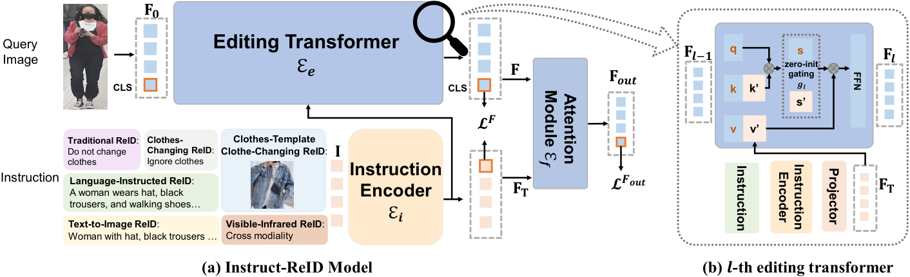</a> <a href="https://openaccess.thecvf.com/content/CVPR2024/papers/He_Instruct-ReID_A_Multi-purpose_Person_Re-identification_Task_with_Instructions_CVPR_2024_paper.pdf">Figure 3 · PDF</a> |
| arXiv 2024 | MLLMReID | [Paper](https://arxiv.org/abs/2401.13201) | — | `General ReID` `MLLM` | <a href="assets/frameworks/mllmreid.png">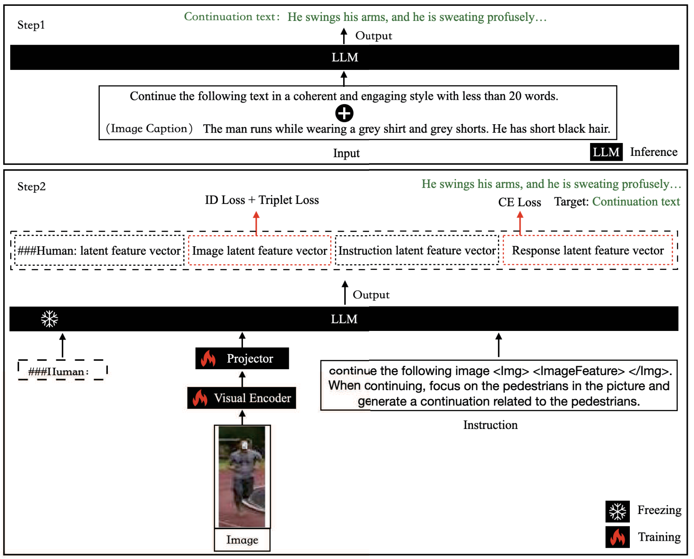</a> <a href="https://arxiv.org/pdf/2401.13201v3">Figure 2 · PDF</a> |
| arXiv 2025 | MMReID-Bench | [Paper](https://arxiv.org/abs/2508.06908) | — | `ReID Benchmark` `MLLM Evaluation` | <a href="assets/frameworks/mmreid-bench.png">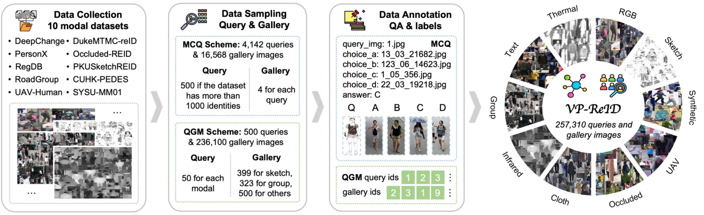</a> <a href="https://arxiv.org/pdf/2508.06908v2">Figure 2 · PDF</a> |

### 2.3 Text-to-Image Person Re-Identification

**研究重点：** 利用自然语言描述和视觉信息之间的语义关联，实现文本到行人图像的跨模态检索，并提升跨数据集泛化能力。

| Venue | Method | Paper | Code | Direction Tags | Framework |
|---|---|---|---|---|---|
| Findings of ACL 2026 | Auto-ReID | [Paper](https://aclanthology.org/2026.findings-acl.312/) | [Code](https://github.com/GridNexus/Auto-ReID) | `T2I-ReID` `Self-Correction` | <a href="assets/frameworks/auto-reid.png">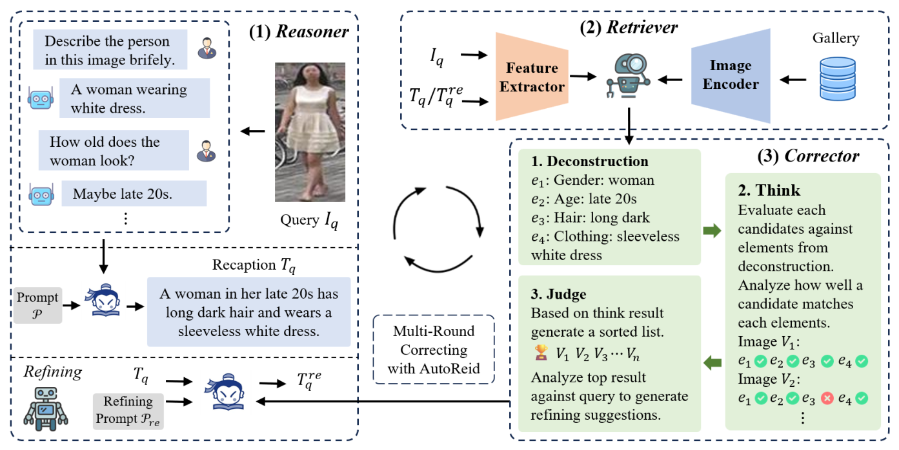</a> <a href="https://aclanthology.org/2026.findings-acl.312.pdf">Figure 1 · PDF</a> · <a href="https://creativecommons.org/licenses/by/4.0/">CC BY 4.0</a> |
| CVPR 2025 | HAM + UPS | [Paper](https://openaccess.thecvf.com/content/CVPR2025/html/Jiang_Modeling_Thousands_of_Human_Annotators_for_Generalizable_Text-to-Image_Person_Re-identification_CVPR_2025_paper.html) | [Code](https://github.com/MPI-Lab/HAM) | `T2I-ReID` `Annotator Modeling` | <a href="assets/frameworks/annotator-reid.png">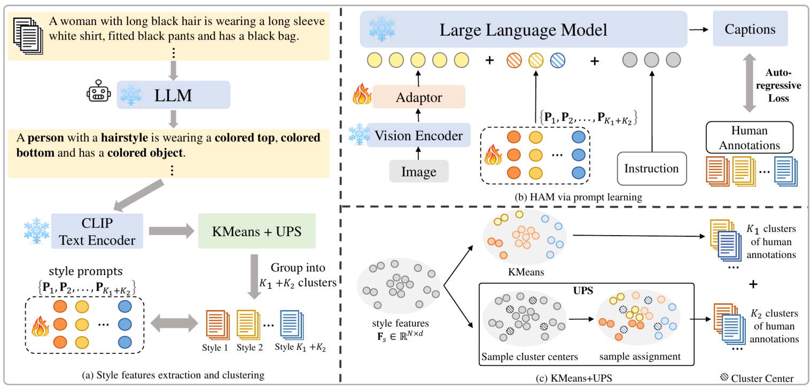</a> <a href="https://openaccess.thecvf.com/content/CVPR2025/papers/Jiang_Modeling_Thousands_of_Human_Annotators_for_Generalizable_Text-to-Image_Person_Re-identification_CVPR_2025_paper.pdf">Figure 2 · PDF</a> |
| Findings of EMNLP 2025 | PVTNL | [Paper](https://aclanthology.org/2025.findings-emnlp.1181/) | — | `T2I-ReID` `Vision-Language Prompting` | <a href="assets/frameworks/pvtnl.png">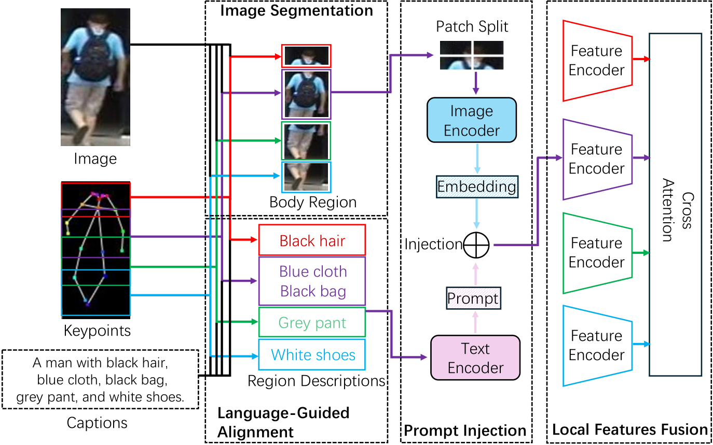</a> <a href="https://aclanthology.org/2025.findings-emnlp.1181.pdf">Figure 2 · PDF</a> · <a href="https://creativecommons.org/licenses/by/4.0/">CC BY 4.0</a> |
| CVPR 2024 | MLLM4Text-ReID | [Paper](https://openaccess.thecvf.com/content/CVPR2024/html/Tan_Harnessing_the_Power_of_MLLMs_for_Transferable_Text-to-Image_Person_ReID_CVPR_2024_paper.html) | [Code](https://github.com/MPI-Lab/MLLM4Text-ReID) | `T2I-ReID` `Transferability` | <a href="assets/frameworks/mllm4text-reid.png">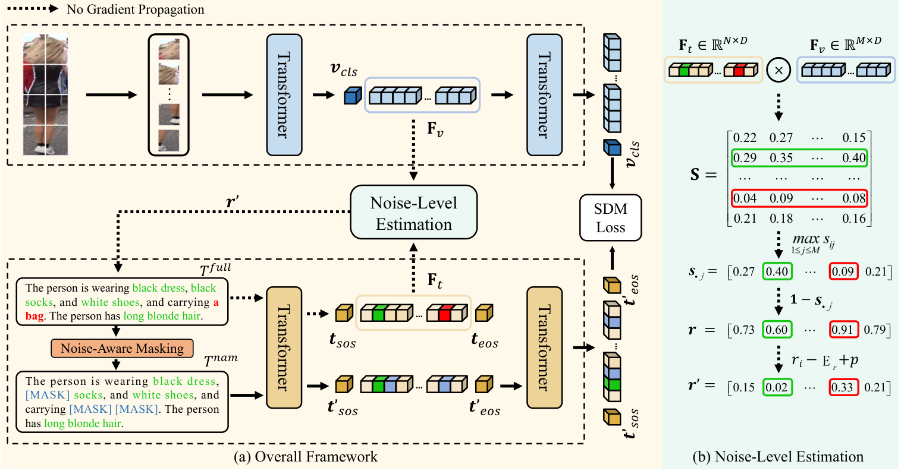</a> <a href="https://arxiv.org/pdf/2405.04940v3">Figure 2 · PDF</a> |

### 2.4 Domain Generalization and Multimodal Alignment

**研究重点：** 通过视觉与语言的多粒度语义对齐，增强模型对不同场景、不同数据域的适应能力。

| Venue | Method | Paper | Code | Direction Tags | Framework |
|---|---|---|---|---|---|
| IET Computer Vision 2026 | MUVA | [Paper](https://ietresearch.onlinelibrary.wiley.com/doi/10.1049/cvi2.70062) | [Code](https://github.com/RikoLi/MUVA) | `Domain Generalization` `Multimodal Alignment` | <a href="assets/frameworks/muva.png">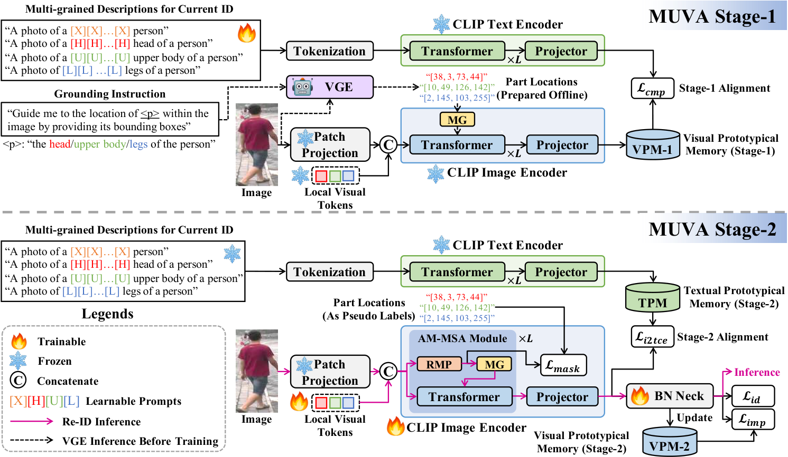</a> <a href="https://arxiv.org/pdf/2603.14012v1">Figure 2 · PDF</a> |
| arXiv 2026 | MUSE | [Paper](https://arxiv.org/abs/2606.16161) | [Code](https://github.com/RikoLi/MUSE) | `Domain Generalization` `Re-ranking` `MLLM` | <a href="assets/frameworks/muse.png">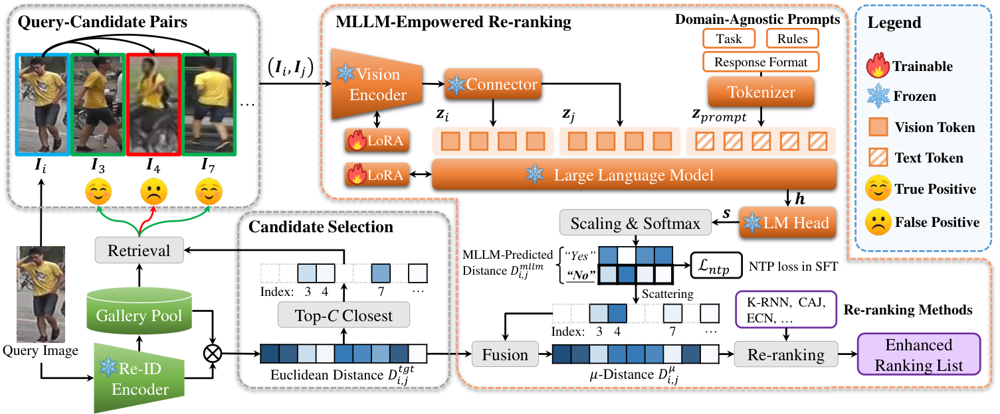</a> <a href="https://arxiv.org/pdf/2606.16161v1">Figure 2 · PDF</a> |

### 2.5 Object Re-Identification

**研究重点：** 探索多模态大模型的推理和视觉上下文学习能力在目标重识别中的应用。

| Venue | Method | Paper | Code | Direction Tags | Framework |
|---|---|---|---|---|---|
| CVPR 2026 | CoT-ReID | [Paper](https://openaccess.thecvf.com/content/CVPR2026/html/Gao_Chain-of-Thought_Guided_Multi-Modal_Object_Re-Identification_CVPR_2026_paper.html) | [Code](https://github.com/Gaoya615/CoT-ReID) | `Object ReID` `Chain-of-Thought` |  <a href="https://openaccess.thecvf.com/content/CVPR2026/papers/Gao_Chain-of-Thought_Guided_Multi-Modal_Object_Re-Identification_CVPR_2026_paper.pdf">Figure 4 · PDF</a> |
| ICCV 2025 | VICP | [Paper](https://openaccess.thecvf.com/content/ICCV2025/html/Huang_Generalizable_Object_Re-Identification_via_Visual_In-Context_Prompting_ICCV_2025_paper.html) | [Code](https://github.com/Hzzone/VICP) | `Object ReID` `Visual In-Context Prompting` | <a href="assets/frameworks/vicp-reid.png">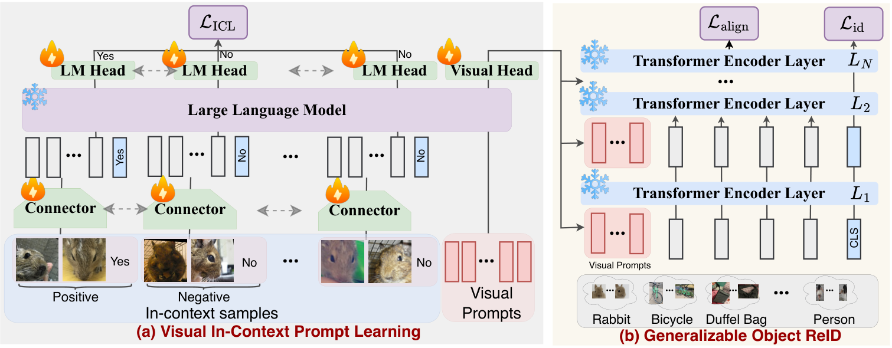</a> <a href="https://openaccess.thecvf.com/content/ICCV2025/papers/Huang_Generalizable_Object_Re-Identification_via_Visual_In-Context_Prompting_ICCV_2025_paper.pdf">Figure 2 · PDF</a> |

### 2.6 ReID Framework and Benchmark

**研究重点：** 构建面向大模型的 ReID 任务体系和评测基准，研究指令理解、检索能力及多任务适应能力。

| Venue | Method | Paper | Code | Direction Tags | Framework |
|---|---|---|---|---|---|
| arXiv 2025 | MMReID-Bench | [Paper](https://arxiv.org/abs/2508.06908) | — | `ReID Benchmark` `MLLM Evaluation` |  <a href="https://arxiv.org/pdf/2508.06908v2">Figure 2 · PDF</a> |
| CVPR 2024 | Instruct-ReID | [Paper](https://openaccess.thecvf.com/content/CVPR2024/html/He_Instruct-ReID_A_Multi-purpose_Person_Re-identification_Task_with_Instructions_CVPR_2024_paper.html) | [Code](https://github.com/hwz-zju/Instruct-ReID) | `Instruction Following` `Multi-task ReID` |  <a href="https://openaccess.thecvf.com/content/CVPR2024/papers/He_Instruct-ReID_A_Multi-purpose_Person_Re-identification_Task_with_Instructions_CVPR_2024_paper.pdf">Figure 3 · PDF</a> |

---

## 3. Related MLLM Retrieval / Re-ranking

### 3.1 Multimodal Retrieval and Embedding

**研究重点：** 利用 MLLM 学习高质量的多模态向量表示，增强图像、文本及跨模态检索能力。

| Venue | Method | Paper | Code / Project | Direction Tags | Framework |
|---|---|---|---|---|---|
| ICLR 2026 | U-MARVEL | [Paper](https://arxiv.org/abs/2507.14902) | [Code](https://github.com/chaxjli/U-MARVEL) | `Multimodal Retrieval` `Embedding Learning` | <a href="assets/frameworks/u-marvel.png">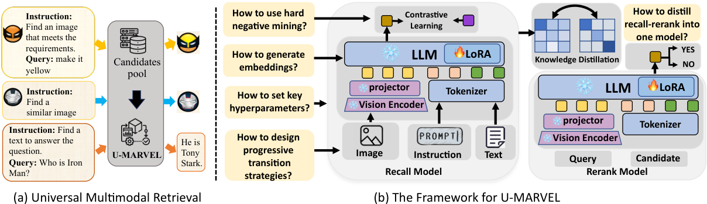</a> <a href="https://arxiv.org/pdf/2507.14902v2">Figure 1 · PDF</a> |
| ICML 2026 | FreeRet | [Paper](https://proceedings.mlr.press/v306/zhu26ba.html) | [Code](https://github.com/MCG-NJU/FreeRet) | `Multimodal Retrieval` `Training-Free` | <a href="assets/frameworks/freeret.png">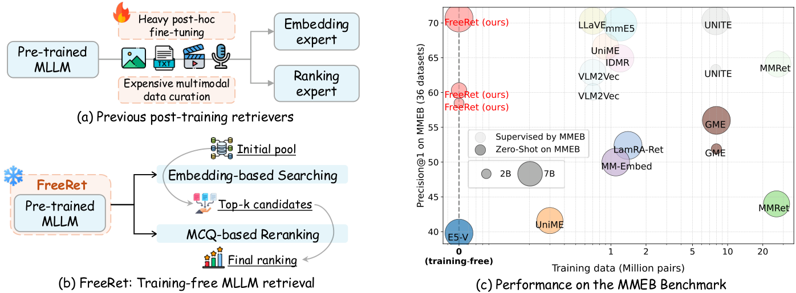</a> <a href="https://arxiv.org/pdf/2509.24621v3">Figure 1 · PDF</a> |
| ICLR 2025 | MM-Embed | [Paper](https://openreview.net/forum?id=i45NQb2iKO) | [Project / Model](https://huggingface.co/nvidia/MM-Embed) | `Multimodal Retrieval` `Embedding` | <a href="assets/frameworks/mm-embed.png">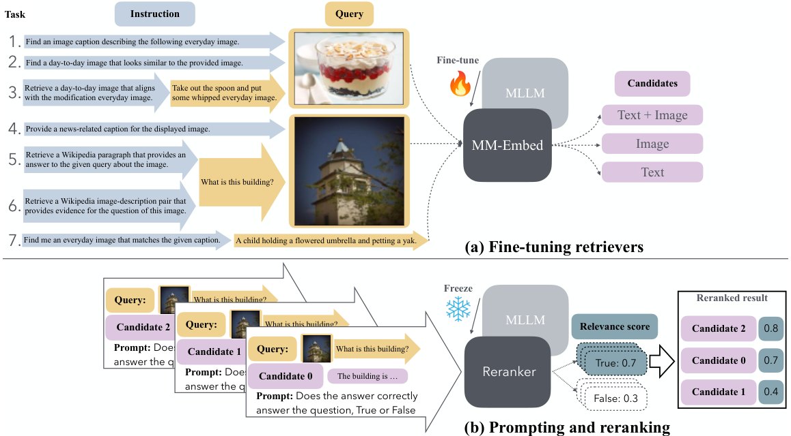</a> <a href="https://arxiv.org/pdf/2411.02571v2">Figure 1 · PDF</a> |
| ICLR 2025 | VLM2Vec | [Paper](https://proceedings.iclr.cc/paper_files/paper/2025/hash/04261fce1705c4f02f062866717d592a-Abstract-Conference.html) | [Code](https://github.com/TIGER-AI-Lab/VLM2Vec) | `Multimodal Embedding` `Vision-Language` | <a href="assets/frameworks/vlm2vec.png">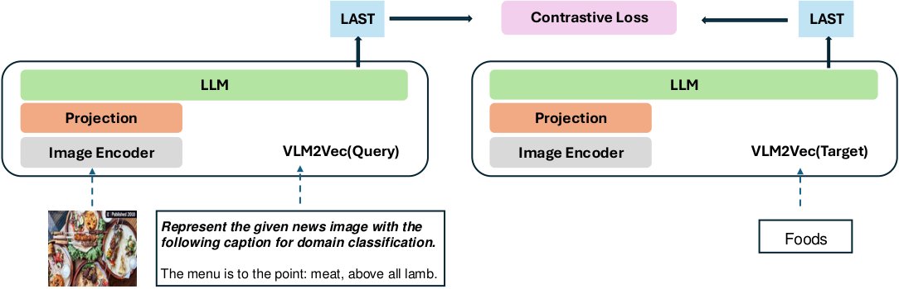</a> <a href="https://arxiv.org/pdf/2410.05160v3">Figure 3 · PDF</a> |

### 3.2 Re-ranking

**研究重点：** 利用大模型的视觉理解和语义推理能力，对初始检索结果进行重新评估和排序，提高最终检索质量。

| Venue | Method | Paper | Code | Direction Tags | Framework |
|---|---|---|---|---|---|
| arXiv 2025 | CoTRR | [Paper](https://arxiv.org/abs/2509.14746) | [Code](https://github.com/freshfish15/CoTRR) | `Re-ranking` `Chain-of-Thought` | <a href="assets/frameworks/cotrr.png">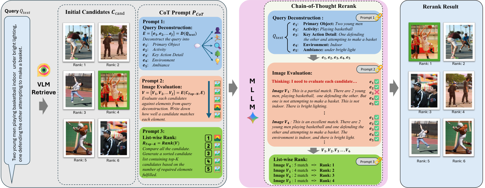</a> <a href="https://arxiv.org/pdf/2509.14746v1">Figure 1 · PDF</a> |
| arXiv 2026 | MUSE | [Paper](https://arxiv.org/abs/2606.16161) | [Code](https://github.com/RikoLi/MUSE) | `Re-ranking` `MLLM` `Domain Generalization` |  <a href="https://arxiv.org/pdf/2606.16161v1">Figure 2 · PDF</a> |

### 3.3 Composed Image Retrieval

**研究重点：** 根据用户提供的参考图像和自然语言修改指令，检索符合组合条件的目标图像。

| Venue | Method | Paper | Code / Project | Direction Tags | Framework |
|---|---|---|---|---|---|
| CVPR 2026 | ReCALL | [Paper](https://openaccess.thecvf.com/content/CVPR2026/html/Yang_ReCALL_Recalibrating_Capability_Degradation_for_MLLM-based_Composed_Image_Retrieval_CVPR_2026_paper.html) | [Code](https://github.com/RemRico/Recall) | `Composed Image Retrieval` `Capability Calibration` | <a href="assets/frameworks/recall.png">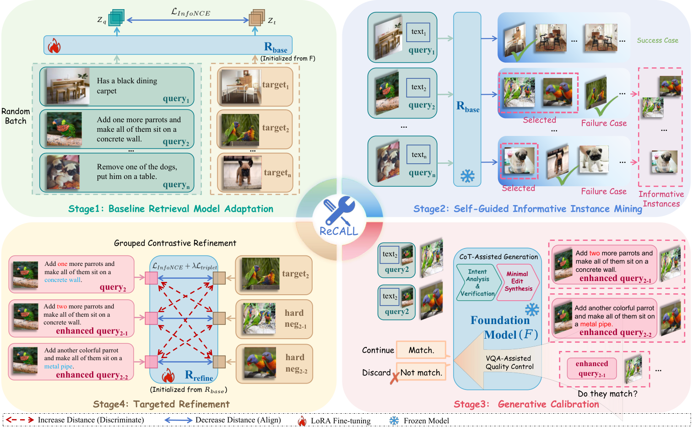</a> <a href="https://arxiv.org/pdf/2602.01639v2">Figure 2 · PDF</a> |
| AAAI 2025 | CIR-LVLM | [Paper](https://ojs.aaai.org/index.php/AAAI/article/view/32768) | — | `Composed Image Retrieval` `User Intent` | <a href="assets/frameworks/cir-lvlm.png">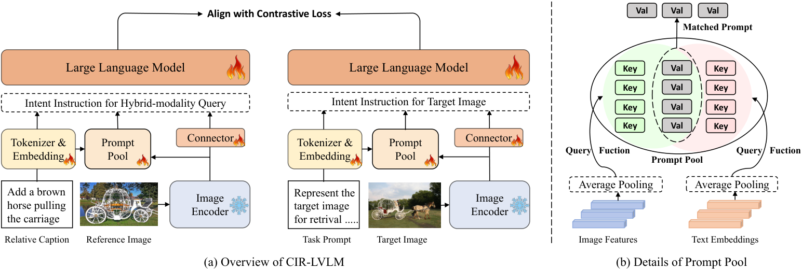</a> <a href="https://arxiv.org/pdf/2412.11087v1">Figure 2 · PDF</a> |
| ICCV 2025 | DistillCIR | [Paper](https://openaccess.thecvf.com/content/ICCV2025/html/Zhong_Zero-Shot_Composed_Image_Retrieval_via_Dual-Stream_Instruction-Aware_Distillation_ICCV_2025_paper.html) | [Project / Model](https://distillcir.github.io/) | `Composed Image Retrieval` `Knowledge Distillation` | <a href="assets/frameworks/distillcir.png">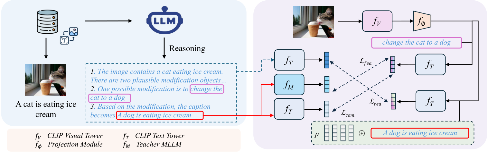</a> <a href="https://openaccess.thecvf.com/content/ICCV2025/papers/Zhong_Zero-Shot_Composed_Image_Retrieval_via_Dual-Stream_Instruction-Aware_Distillation_ICCV_2025_paper.pdf">Figure 2 · PDF</a> |
| arXiv 2025 | SoFT | [Paper](https://arxiv.org/abs/2512.20781) | [Code](https://github.com/jjungyujin/SoFT) | `Composed Image Retrieval` `Zero-Shot Retrieval` | <a href="assets/frameworks/soft.png">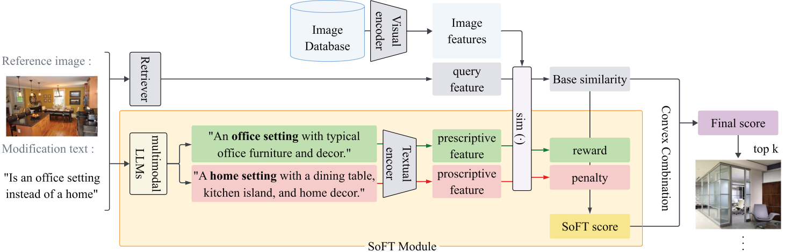</a> <a href="https://arxiv.org/pdf/2512.20781v1">Figure 2 · PDF</a> |

## 4. 自动发现的论文

GitHub Actions 每周一 09:17（北京时间）搜索 arXiv、OpenAlex 和 Crossref 最近 60 天的结果。符合 MLLM / LVLM 与 ReID 方向的论文会自动收录在下表，按发布日期排序。[查看运行记录或手动触发](https://github.com/Away-UPUP/MLLM-Related-ReID/actions/workflows/update-papers.yml)。

<!-- discovered-papers:start -->
| Publication date | Paper | Source |
|---|---|---|
<!-- discovered-papers:end -->
